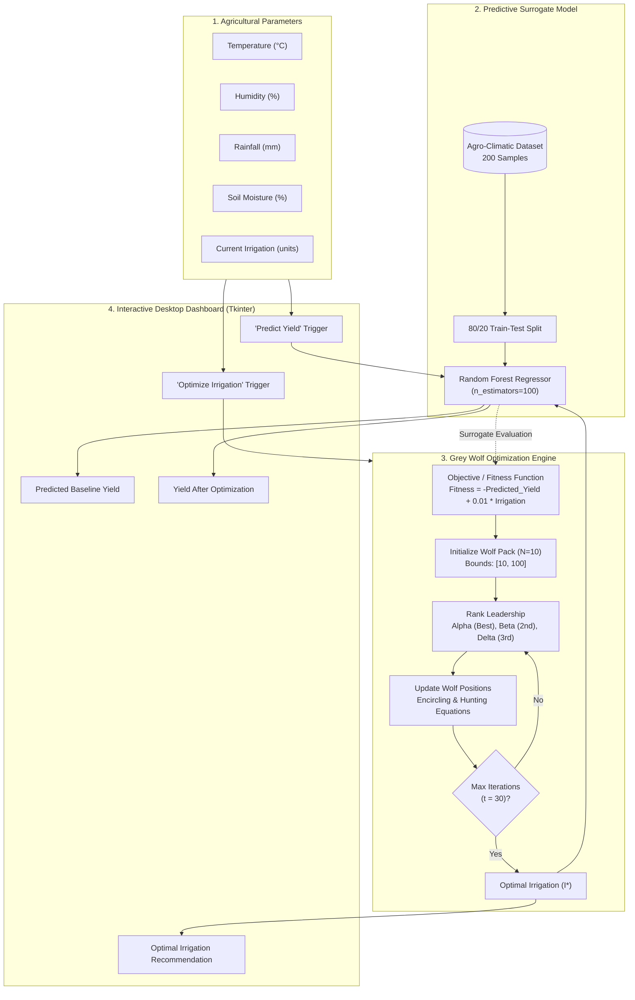

# 🌱 OptiCrop: Grey Wolf–Optimized Irrigation & Yield Forecasting

[](https://www.python.org/)
[](https://scikit-learn.org/)
[](https://doi.org/10.1016/j.advengsoft.2013.12.007)
[](https://docs.python.org/3/library/tkinter.html)
[](LICENSE)

**OptiCrop** is an intelligent precision agriculture system combining **Machine Learning** (`Random Forest Regressor`) and **Bio-Inspired Metaheuristics** (`Grey Wolf Optimization - GWO`) with an interactive **Tkinter GUI**. It predicts crop yields from environmental conditions and calculates the optimal irrigation volume to **maximize agricultural yield while minimizing water consumption**.

---

## 📑 Table of Contents

- [Overview & Motivation](#-overview--motivation)
- [Key Features](#-key-features)
- [System Architecture](#-system-architecture)
- [Methodology & Technical Details](#-methodology--technical-details)
  - [1. Agro-Climatic Dataset & Synthetic Modeling](#1-agro-climatic-dataset--synthetic-modeling)
  - [2. Yield Forecasting Engine (Random Forest)](#2-yield-forecasting-engine-random-forest)
  - [3. Grey Wolf Optimization (GWO) for Water Allocation](#3-grey-wolf-optimization-gwo-for-water-allocation)
  - [4. Interactive Graphical User Interface (GUI)](#4-interactive-graphical-user-interface-gui)
- [Performance & Benchmark Results](#-performance--benchmark-results)
- [Repository Structure](#-repository-structure)
- [Getting Started](#-getting-started)
  - [Prerequisites](#prerequisites)
  - [Installation](#installation)
  - [Running the Project](#running-the-project)
- [Mathematical Formulation](#-mathematical-formulation)
- [Future Roadmap](#-future-roadmap)
- [Contributing](#-contributing)
- [License & Acknowledgments](#-license--acknowledgments)

---

## 🌟 Overview & Motivation

Agriculture accounts for approximately **70% of freshwater withdrawals globally**. Inefficient irrigation practices cause severe water depletion, soil degradation, and sub-optimal crop yields. Traditional methods either rely on static heuristic schedules or purely predictive ML models that only answer *"What will my yield be?"* without answering the operational question:

> **"Exactly how much irrigation should be applied right now to achieve the highest possible yield without wasting water?"**

**OptiCrop** answers this question by formulating water allocation as a constrained continuous optimization problem solved in real time by the **Grey Wolf Optimizer (GWO)** guided by a trained **Random Forest** predictive surrogate.

---

## ✨ Key Features

- **🌾 Data-Driven Yield Prediction**: Trains an ensemble `RandomForestRegressor` with 100 decision trees to capture non-linear agro-climatic interactions.
- **🐺 Nature-Inspired GWO Engine**: Employs the social hunting hierarchy ($\alpha$, $\beta$, $\delta$, $\omega$ wolves) to rapidly converge to optimal irrigation settings without requiring differentiable objective functions.
- **💧 Dual-Objective Optimization**: Simulates a Pareto-efficient balance between maximizing total crop yield (tons) and penalizing excessive water usage (irrigation units).
- **🖥️ Native Desktop GUI**: Built with Python's `tkinter` and `ttk` for seamless user interaction, real-time prediction, parameter clearing, and visual before/after comparison.
- **⚡ Lightweight & Fast**: Convergence achieved in 30 iterations across 10 search agents in less than a second on standard consumer hardware.

---

## 🏗️ System Architecture



---

## 🔬 Methodology & Technical Details

### 1. Agro-Climatic Dataset & Synthetic Modeling

The project synthesizes 200 realistic agro-climatic observations using NumPy uniform distributions:

| Variable | Range / Distribution | Description |
| :--- | :--- | :--- |
| `temperature` | $20.0 - 40.0 \text{ °C}$ | Ambient ambient field temperature |
| `humidity` | $40.0 - 90.0\text{ \%}$ | Atmospheric relative humidity |
| `rainfall` | $0.0 - 200.0\text{ mm}$ | Natural precipitation |
| `soil_moisture`| $20.0 - 80.0\text{ \%}$ | Volumetric water content in topsoil |
| `irrigation` | $10.0 - 100.0\text{ units}$ | Artificially applied water volume |

#### Underlying Agronomic Yield Equation
The synthetic ground truth reflects agricultural realities, including linear benefits from water inputs and a quadratic penalty for temperature deviations away from the optimal $30\text{ °C}$:

$$\text{Yield} = 0.05 \cdot \text{soil\_moisture} + 0.03 \cdot \text{rainfall} + 0.08 \cdot \text{irrigation} - 0.02 \cdot (\text{temperature} - 30)^2 + \epsilon$$

*where $\epsilon \sim \mathcal{N}(0, 1)$ represents stochastic environmental noise.*

---

### 2. Yield Forecasting Engine (Random Forest)

- **Algorithm**: `sklearn.ensemble.RandomForestRegressor`
- **Hyperparameters**: `n_estimators=100`, `random_state=42`
- **Data Partition**: 80% Training ($160$ samples), 20% Testing ($40$ samples)
- **Model Evaluation**:
  - **Mean Absolute Error (MAE)**: $\approx 1.10\text{ tons}$
  - **Coefficient of Determination ($R^2$)**: $\approx 0.789$ ($78.91\%$ variance explained)

---

### 3. Grey Wolf Optimization (GWO) for Water Allocation

The Grey Wolf Optimizer mimics the leadership hierarchy and hunting strategy of grey wolves in nature:
1. **$\alpha$ (Alpha)**: The leader wolf directing the pack (best solution found).
2. **$\beta$ (Beta)**: Subordinate advisor wolf (second best solution).
3. **$\delta$ (Delta)**: Sentinel / scout wolf (third best solution).
4. **$\omega$ (Omega)**: Rest of the pack tracking the leaders.

#### Mathematical Formulations

1. **Encircling Prey**:
   $$\vec{D}_\alpha = |\vec{C}_1 \cdot \vec{X}_\alpha - \vec{X}_i|, \quad \vec{X}_1 = \vec{X}_\alpha - \vec{A}_1 \cdot \vec{D}_\alpha$$
   $$\vec{D}_\beta = |\vec{C}_2 \cdot \vec{X}_\beta - \vec{X}_i|, \quad \vec{X}_2 = \vec{X}_\beta - \vec{A}_2 \cdot \vec{D}_\beta$$
   $$\vec{D}_\delta = |\vec{C}_3 \cdot \vec{X}_\delta - \vec{X}_i|, \quad \vec{X}_3 = \vec{X}_\delta - \vec{A}_3 \cdot \vec{D}_\delta$$

2. **Position Update**:
   $$\vec{X}_i(t+1) = \frac{\vec{X}_1 + \vec{X}_2 + \vec{X}_3}{3}$$

3. **Exploration / Exploitation Parameter**:
   $$a = 2 - t \cdot \left(\frac{2}{\text{max\_iter}}\right), \quad A = 2a \cdot r_1 - a, \quad C = 2 \cdot r_2$$
   *where $r_1, r_2 \in [0, 1]$ are uniform random numbers.*

#### Multi-Objective Fitness Function
The GWO algorithm minimizes a custom fitness function balancing high crop yield with conservation of water resources:

$$\text{Fitness}(I) = -\hat{Y}(I) + \lambda \cdot I$$

- $\hat{Y}(I)$: Yield predicted by the trained Random Forest model for irrigation candidate $I$.
- $\lambda = 0.01$: Penalty weight coefficient for water consumption.
- Lower fitness values correspond to superior agronomic outcomes.

---

### 4. Interactive Graphical User Interface (GUI)

The desktop application is built with Python's standard `tkinter` and `ttk` libraries:
- **Clean Input Panel**: Grid layout with input validation for temperature, humidity, rainfall, soil moisture, and current irrigation.
- **Predict Yield**: Evaluates the model on user inputs with immediate visual feedback.
- **Optimize Irrigation**: Dynamically invokes the GWO loop and displays recommended water levels and the projected boosted yield.
- **Clear**: Instantly resets form fields and dashboard results.

---

## 📊 Performance & Benchmark Results

### Simulation Case Study

| Scenario | Temperature | Humidity | Rainfall | Soil Moisture | Irrigation | Predicted Yield | Fitness Score |
| :--- | :---: | :---: | :---: | :---: | :---: | :---: | :---: |
| **Baseline Input** | $30\text{ °C}$ | $70\text{ \%}$ | $50\text{ mm}$ | $50\text{ \%}$ | $60.00\text{ units}$ | **$8.64\text{ tons}$** | $-8.04$ |
| **GWO-Optimized** | $30\text{ °C}$ | $70\text{ \%}$ | $50\text{ mm}$ | $50\text{ \%}$ | **$89.46\text{ units}$** | **$9.69\text{ tons}$** | **$-8.80$** |
| **Net Improvement**| — | — | — | — | $+29.46\text{ units}$ | **$+1.05\text{ tons}$ (+12.2%)**| **Optimal** |

---

## 📁 Repository Structure

```text
OptiCrop — Grey Wolf–Optimized Irrigation & Yield Forecasting/
├── main.ipynb          # End-to-end Jupyter Notebook (Data, Model, GWO, GUI)
├── .gitattributes      # Line ending normalization settings
└── README.md           # Project documentation & architectural manual
```

---

## 🚀 Getting Started

### Prerequisites

Ensure you have **Python 3.9+** installed on your system.

Verify your installation:
```bash
python --version
```

### Installation

1. **Clone the repository**:
   ```bash
   git clone https://github.com/lahaSL/OptiCrop-Grey-Wolf-Optimized-Irrigation-Yield-Forecasting.git
   cd OptiCrop-Grey-Wolf-Optimized-Irrigation-Yield-Forecasting
   ```

2. **Create and activate a virtual environment** (recommended):
   ```bash
   # Windows (PowerShell)
   python -m venv venv
   .\venv\Scripts\Activate.ps1

   # Linux / macOS
   python3 -m venv venv
   source venv/bin/activate
   ```

3. **Install required dependencies**:
   ```bash
   pip install numpy pandas scikit-learn notebook
   ```
   *(Note: `tkinter` is included by default with standard Python desktop installations on Windows and macOS. On Ubuntu/Debian, install with `sudo apt-get install python3-tk` if prompted).*

### Running the Project

#### Option 1: Run via Jupyter Notebook
Launch the notebook environment:
```bash
jupyter notebook main.ipynb
```
Execute the cells sequentially from top to bottom. The final cell will launch the interactive Tkinter desktop GUI window.

#### Option 2: Run Desktop GUI Directly
If you export the final code cell to a Python file (e.g. `app.py`):
```bash
python app.py
```

---

## 🧮 Mathematical Formulation

```text
Minimize:
    f(I) = -RF_predict([T, H, R, S, I]) + 0.01 * I

Subject to:
    10 <= I <= 100
    T, H, R, S in R+ (Fixed ambient conditions)
```

---

## 🔮 Future Roadmap

- [ ] **Real-world IoT Integration**: Connect with real-time soil moisture (capacitive/resistive sensors) and ESP32/Raspberry Pi microcontrollers.
- [ ] **Weather API Synchronization**: Integrate real-time weather forecasts (OpenWeatherMap API) for dynamic predictive scheduling.
- [ ] **Multi-Crop Modeling**: Expand datasets to include crop-specific yield curves (wheat, corn, rice, cotton).
- [ ] **Multi-Objective Pareto Frontier**: Implement multi-objective algorithms (e.g. MOGWO / NSGA-II) to visualize trade-offs between water, fertilizer, and electricity costs.
- [ ] **Web Deployment**: Build a modern web application frontend using FastAPI and React/Tailwind.

---

## 🤝 Contributing

Contributions, issues, and feature requests are welcome!

1. Fork the Project
2. Create your Feature Branch (`git checkout -b feature/AmazingFeature`)
3. Commit your Changes (`git commit -m 'Add some AmazingFeature'`)
4. Push to the Branch (`git push origin feature/AmazingFeature`)
5. Open a Pull Request

---

## 📜 License & Acknowledgments

This project is licensed under the [MIT License](LICENSE).

### Acknowledgments
- **Seyedali Mirjalili et al.** for the original publication on the *Grey Wolf Optimizer* (*Advances in Engineering Software*, 2014).
- The Scikit-Learn and Scientific Python community for robust machine learning and numerical computation libraries.
